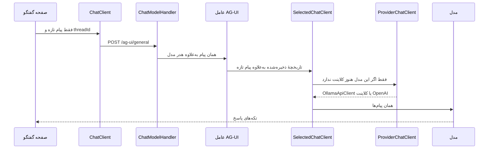

# مسیر گفتگو

این یادداشت جای تنظیم‌های گفتگو را روی کد فعلی مشخص می‌کند. سه کلاینت پیام را جابه‌جا می‌کنند. رفتار دستیار روی خود عامل تنظیم می‌شود.

## سه نقش



**ChatClient** درِ صفحه است. کلاس خود پروژه نیست. نمونهٔ `AGUIChatClient` است که در `src/Maf.Client/Program.cs` به‌جای `IChatClient` ثبت شده. صفحهٔ `Chat.razor` هر بار فقط پیام تازهٔ کاربر را می‌فرستد. خط‌های قبلی روی صفحه می‌مانند تا کاربر ببیند، ولی دوباره به مدل فرستاده نمی‌شوند. این کلاینت Ollama و OpenAI را نمی‌شناسد و درخواست گفتگوی عمومی را به `/ag-ui/general` می‌فرستد. شناسهٔ گفتگو همان `threadId` پروتکل AG-UI است. صفحه آن را از رویداد `RUN_STARTED` برمی‌دارد و در ادامه فقط با `RunAgentInput.ThreadId` دوباره می‌فرستد. اگر پروتکل مدل Responses باشد و OpenAI برای این گفتگو شناسهٔ مکالمه برگردانده باشد، نوبت بعد با همان شناسه ادامه پیدا می‌کند و متن جدول دوباره به مدل فرستاده نمی‌شود. برای بقیهٔ مدل‌ها `StoredChatHistoryProvider` پیام‌های ذخیره‌شده را جلوتر از پیام تازه می‌گذارد. `ChatTurnRecorder` در هر دو حالت متن قابل‌دیدن را در جدول می‌نویسد تا بعداً همان گفتگو باز شود. فایل کنار پیام کاربر در جدول `ChatAttachments` به‌صورت base64 ذخیره می‌شود و برای مدل‌هایی که تاریخچه را از جدول می‌خوانند، دوباره به‌صورت بخش فایل همان پیام برمی‌گردد. شمارش توکن هر دور، از گزارش خود مدل روی جریان پاسخ جمع می‌شود و در جدول `ChatTurnUsages` کنار پاسخ دستیار می‌ماند: ورودی، خروجی، استدلال، کش خوانده‌شده، نوشتن کش و کل. اگر مدل عددی نفرستد، آن ستون خالی می‌ماند. دستور عامل انگلیسی است و از مدل می‌خواهد به زبان کاربر و با مارک‌داون جواب بدهد. صفحه همان متن را رسم می‌کند و تکه‌های جریان، مثل استدلال و صدای ابزار، جدا نشان داده می‌شوند. اگر کاربر ارسال را قطع کند، پاسخ دستیار «عملیات توسط کاربر لغو شد» است. برای هر خطای دیگر، پاسخ دستیار «خطا نامشخص رخ داد» است. جزئیات خطا در متن گفتگو نوشته نمی‌شود.

مدل انتخاب‌شده داخل خود پیام نیست. صفحه آن را در `ChatSelection` می‌گذارد و `ChatModelHandler` فقط روی مسیر `/ag-ui` دو هدر اضافه می‌کند: `X-Chat-Provider` و `X-Chat-Model`.

**SelectedChatClient** درِ سرور است. هنگام بالا آمدن برنامه سه بار با `AsAIAgent` به سه عامل تبدیل می‌شود و هر کدام روی مسیر خودش می‌نشیند: `general` روی `/ag-ui/general`، `prompt` روی `/ag-ui/prompt`، و `workflow` روی `/ag-ui/workflow`. دستور هر سه فعلاً یکی است. با رسیدن درخواست، هدرها را می‌خواند، ارائه‌دهنده و مدل را از دیتابیس درمی‌آورد، و پیام‌ها را به کلاینت همان مدل می‌سپارد. دیکشنری‌اش گفتگو را نگه نمی‌دارد. فقط کلاینت اتصال را نگه می‌دارد، چون این کلاس در کل برنامه یکی است و هر پیام ممکن است مدل دیگری بخواهد. کلید دیکشنری نوع، پروتکل، نشانی، نام مدل و کلید API است. ساختن `OllamaApiClient` برای هر پیام یک `HttpClient` تازه می‌سازد.

**ProviderChatClient** در مسیر هر پیام نیست. یک کارخانه است و فقط بار اولِ هر کلید صدا زده می‌شود. برای Ollama یک `OllamaApiClient` روی ریشهٔ اصلی کشف مدل‌ها می‌سازد. برای OpenAI و سازگار با OpenAI همان SDK اوپن‌ای است. پروتکل ذخیره‌شده `GetChatClient` یا `GetResponsesClient` را انتخاب می‌کند. Ollama پروتکل Responses ندارد و همیشه API خودش را می‌گیرد.

دستور «تو یک دستیار مفید هستی...» مال صفحه نیست. موقع `AsAIAgent` به گزینه‌های عامل اضافه می‌شود.

## کجا چه چیزی تنظیم می‌شود

| کار | جا |
| --- | --- |
| دستور، دما، سقف توکن، ابزار ثابت | `AsAIAgent` با `ChatClientAgentOptions` |
| تنظیم فقط برای همین پیام | آرگومان `ChatOptions` در `GetStreamingResponseAsync` صفحه |
| زمینه و دستور اضافه‌شوندهٔ هر اجرا | `AIContextProviders` روی همان گزینه‌های عامل |
| تاریخچهٔ سمت سرور | `ChatHistoryProvider` روی عامل، و `AgentSessionStore` با کلید نام عامل |
| انتخاب مدل و دست‌کاری `ChatOptions` رسیده | `SelectedChatClient` |
| نشانی، کلید، نام مدل، پروتکل SDK | `ProviderChatClient` |

### بلوک `AsAIAgent` و `MapAGUIServer`

اینجا تنظیم دستیار است و برای همهٔ مدل‌ها یکی است. امضای فعلی `instructions`، `name`، `description` و `tools` می‌گیرد. برای بقیه، همان فراخوانی با `ChatClientAgentOptions` نوشته می‌شود:

- `ChatOptions` برای دمای پیش‌فرض، سقف توکن، حالت ابزار و دستور.
- `AIContextProviders` برای زمینه‌ای که قبل از هر اجرا به پیام‌ها اضافه می‌شود.
- `ChatHistoryProvider` پیام‌های ذخیره‌شدهٔ همین گفتگو را قبل از مدل می‌گذارد. صفحه فقط پیام تازه را می‌فرستد.

عامل گزینه‌های پیش‌فرض را با گزینه‌های همان درخواست یکی می‌کند. مقدارِ پرِ درخواست جلوتر است و جاهای خالی از پیش‌فرض عامل پر می‌شوند. دستورها به هم چسبانده می‌شوند.

`MapAGUIServer` این گزینه‌ها را پارامتر نمی‌گیرد. برای هر سطح یک `AgentSessionStore` با کلید نام عامل (`general`، `prompt` یا `workflow`) ثبت شده است. این ذخیرهٔ جلسه، خود متن را نگه نمی‌دارد. شناسهٔ رشتهٔ AG-UI را روی جلسهٔ همان درخواست می‌گذارد. اگر پروتکل انتخاب‌شده Responses باشد و برای همین گفتگو شناسهٔ مکالمهٔ OpenAI ذخیره شده باشد، همان شناسه روی جلسه گذاشته می‌شود تا مدل از تاریخچهٔ خودش ادامه دهد. در غیر این صورت `StoredChatHistoryProvider` متن را از جدول گفتگو می‌خواند.

گزینهٔ مخصوص یک پیام از صفحه می‌آید. `MapAGUIServer` آن را روی گزینهٔ اجرای همان درخواست می‌گذارد.

### `SelectedChatClient`

ابزار، زمینه و تاریخچه اینجا تعریف نمی‌شوند. بالاتر، داخل عامل، اعمال شده‌اند. این کلاس `messages` و `ChatOptions` آماده را می‌گیرد و همان‌ها را به کلاینت مدل می‌سپارد. شناسهٔ مکالمهٔ خود مدل دست نمی‌خورد. طول زمینهٔ مدل اینجا به سقف پاسخ تبدیل نمی‌شود.

### `ProviderChatClient`

این تابع یک‌بار برای هر اتصال ساخته می‌شود. فقط چیزهای خود SDK اینجاست: نشانی، کلید، نام مدل، هدر Ollama، و انتخاب Chat Completions یا Responses. دما، ابزار، زمینه و تاریخچه اگر اینجا ثابت شوند تا آخر عمر همان کلاینت قفل می‌مانند.

تاریخچهٔ سمت سرور را در این دیکشنری نگذارید. با وجود Ollama و OpenAI روی یک عامل، متن قابل‌دیدن در جدول گفتگو است و `ChatTurnRecorder` آن را می‌نویسد. اگر پروتکل Responses شناسهٔ مکالمه برگرداند، عامل به‌صورت پیش‌فرض کنار `ChatHistoryProvider` خطا می‌دهد؛ این سه پرچم فقط همان خطا و هشدار را خاموش می‌کنند و شناسه را پاک نمی‌کنند. نوبت بعد، برای Responses، همان شناسه روی جلسه برمی‌گردد و متن جدول دوباره فرستاده نمی‌شود. برای Chat Completions و Ollama شناسه روی جلسه گذاشته نمی‌شود و متن قبلی از جدول خوانده می‌شود.

## انتخاب چند ابزار از صفحه

انتخاب ابزار برای هر پیام است. صفحهٔ گفتگو ابزارهای شناسایی‌شدهٔ سرورهای فعال MCP را از `GET /api/chat/tools` می‌گیرد و چند مورد را در یک فهرست بازشو نشان می‌دهد. هنگام ارسال، `ChatModelHandler` هر انتخاب را در هدر `X-Chat-Tools` به شکل `serverId|name` می‌فرستد. `ChatToolContextProvider` همان نام‌ها را با `IHttpContextAccessor` می‌خواند و از استخر `McpToolPool` همان ابزارهای شناخته‌شدهٔ سرور فعال را در `AIContext.Tools` می‌گذارد. اسم ناشناس یا سرور خاموش ثبت نمی‌شود. اتصال یک سرور اولین بار که یکی از ابزارهایش انتخاب شود ساخته می‌شود و بعد از آن بین درخواست‌ها مشترک می‌ماند. ویرایش، حذف یا شناسایی دوبارهٔ سرور آن اتصال را از استخر برمی‌دارد.

ابزار اسکرین‌شات صفحه ابزار AG-UI سمت کلاینت است. گفتگوی عمومی `capture_page_screenshot` را در `ChatOptions.Tools` می‌فرستد. سرور فقط نام و توضیح را می‌بیند و خودِ گرفتن تصویر در مرورگر اجرا می‌شود. نتیجهٔ ابزار فقط می‌گوید تصویر ذخیره شده و مدل باید فایل را از کاربر بخواهد. خود PNG در فهرست فایل‌های صفحه می‌ماند و با ارسال بعدی، مثل پیوست کاربر، به مدل می‌رسد.

فهرست ابزار خود عامل باید خالی بماند. فریم‌ورک ابزارهای عامل را به ابزارهای درخواست می‌چسباند و انتخاب کاربر دیگر «فقط همین‌ها» نمی‌ماند.

`SelectedChatClient` این فهرست را بعد از لایهٔ اجرای ابزار می‌بیند. `ProviderChatClient` هم کش اتصال است و ابزار این پیام را برای پیام بعدی همان مدل نگه می‌دارد.

همان فراهم‌کننده می‌تواند `Instructions` هم برگرداند. متن فعلی عامل اول در زمینه قرار می‌گیرد و متن فراهم‌کننده با یک خط جدید به آن چسبانده می‌شود. متن عامل پاک نمی‌شود، مگر اینکه ادغام پیش‌فرض عوض شود.

## چند مسیر AG-UI

هر `MapAGUIServer` یک `POST` جدا است و می‌توان چند بار صدا زده شود، به شرطی که مسیرها یکی نباشند. `AddAGUIServer` یک بار می‌ماند.

هر مسیر عامل خودش را می‌گیرد. از یک `SelectedChatClient` می‌شود دو عامل با دستور، ابزار و `AIContextProvider` متفاوت ساخت. جلسه با نام عامل پیدا می‌شود. نام یکسان یعنی یک مخزن جلسه. نام متفاوت یعنی مخزن جدا.

صفحهٔ گفتگوی عمومی `ag-ui/general` را صدا می‌زند. `ChatModelHandler` هر مسیری را که `/ag-ui` داشته باشد می‌شناسد. صفحه‌های `/chat/prompt` و `/chat/workflow` فعلاً فقط مسیر منو هستند و رابط گفتگو ندارند. عامل همان دو مسیر از همین الان مثل گفتگوی عمومی پاسخ می‌دهد.

## میان‌افزار

میان‌افزار Agent Framework در هر سه نقطه قابل تعریف است. هر کدام دور یک لایهٔ متفاوت می‌پیچد.

| جا | دور چه چیزی | کی اجرا می‌شود |
| --- | --- | --- |
| بعد از `AsAIAgent`، قبل از `MapAGUIServer` | خود عامل | یک‌بار برای هر پیام کاربر، قبل از انتخاب مدل |
| روی `SelectedChatClient`، قبل از `AsAIAgent` | مسیریاب مدل | هر بار که مدل صدا زده می‌شود، حتی داخل حلقهٔ ابزار |
| داخل `ProviderChatClient` | کلاینت همان SDK | فقط برای همان اتصال کش‌شده |

میان‌افزار مخصوص یک پیام در نمونهٔ فریم‌ورک با `ChatClientFactory` روی گزینهٔ همان اجرا داده می‌شود. `MapAGUIServer` فعلی فقط `ChatOptions` را پر می‌کند.

### عامل: پاک کردن دادهٔ حساس

کل نوبت کاربر را یک‌بار می‌بیند، قبل از انتخاب مدل. شماره و ایمیل به هیچ مدلی نمی‌رسد و در جواب برگشتی به صفحه هم نمی‌ماند.

```csharp
async Task<AgentResponse> Redact(IEnumerable<ChatMessage> messages, AgentSession? session, AgentRunOptions? options, AIAgent inner, CancellationToken cancellationToken)
{
    var cleaned = messages.Select(message => new ChatMessage(message.Role, HideEmailAndPhone(message.Text))).ToList();
    AgentResponse response = await inner.RunAsync(cleaned, session, options, cancellationToken);
    response.Messages = response.Messages.Select(message => new ChatMessage(message.Role, HideEmailAndPhone(message.Text))).ToList();
    return response;
}

AIAgent agent = selected.AsAIAgent(name: "chat", instructions: "...").AsBuilder().Use(Redact, null).Build();
```

میان‌افزار اجرای ابزار هم با `AsBuilder().Use(...)` روی همین عامل ثبت می‌شود و فقط چون این عامل از `ChatClientAgent` ساخته شده کار می‌کند.

### `SelectedChatClient`: زمان تماس با مدل

هر تماس واقعی با مدل را می‌بیند، از جمله تماس دوباره داخل حلقهٔ ابزار.

```csharp
async Task<ChatResponse> TimeTheModel(IEnumerable<ChatMessage> messages, ChatOptions? options, IChatClient inner, CancellationToken cancellationToken)
{
    var watch = Stopwatch.StartNew();
    ChatResponse response = await inner.GetResponseAsync(messages, options, cancellationToken);
    logger.LogInformation("مدل در {Elapsed} پاسخ داد", watch.Elapsed);
    return response;
}

IChatClient routed = selected.AsBuilder().Use(getResponseFunc: TimeTheModel, getStreamingResponseFunc: null).Build();
```

### `ProviderChatClient`: تکرار مخصوص Ollama

فقط دور کلاینتی می‌پیچد که همان لحظه ساخته و کش می‌شود. تماس OpenAI از آن رد نمی‌شود.

```csharp
async Task<ChatResponse> RetryOllama(IEnumerable<ChatMessage> messages, ChatOptions? options, IChatClient inner, CancellationToken cancellationToken)
{
    try
    {
        return await inner.GetResponseAsync(messages, options, cancellationToken);
    }
    catch (HttpRequestException)
    {
        return await inner.GetResponseAsync(messages, options, cancellationToken);
    }
}

return new OllamaApiClient(root, connection.ModelName)
    .AsBuilder()
    .Use(getResponseFunc: RetryOllama, getStreamingResponseFunc: null)
    .Build();
```
